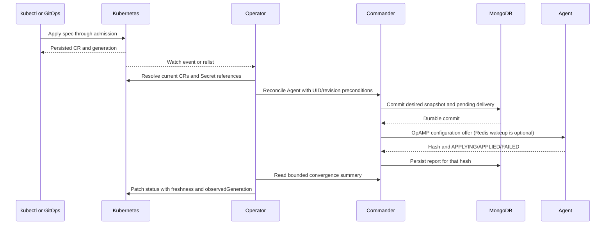
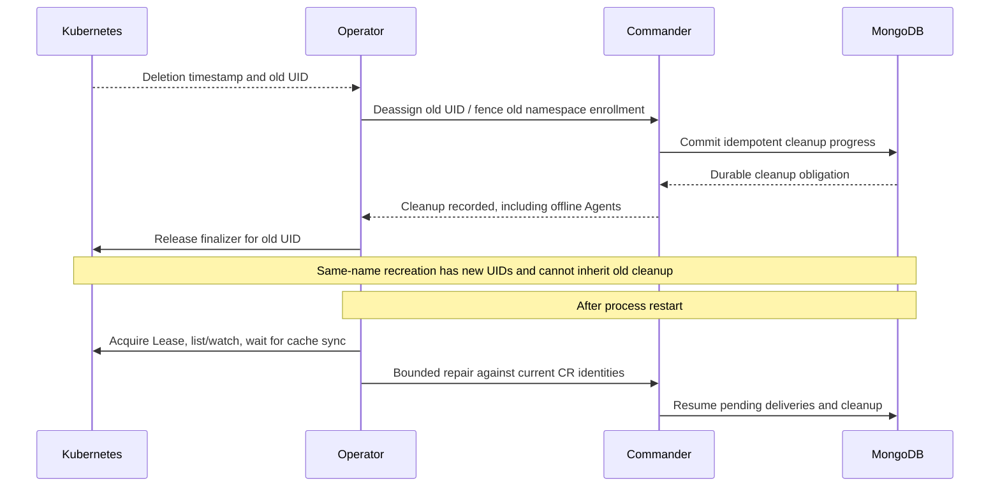

Status: implementation contract, effective when this ADR is merged; work tracked by
[#896](https://github.com/minuk-dev/opampcommander/issues/896).
Decision date: 2026-11-17. Resolves the design scope of
[#897](https://github.com/minuk-dev/opampcommander/issues/897).
This is the target contract, not a claim that the bootstrap implements it.

## Decision and process boundaries

Kubernetes is the only authority for desired management configuration.
The Operator reads that configuration and requests Agent reconciliation through
an authenticated internal Commander runtime API. Commander owns OpAMP sockets,
durable Agent state in MongoDB, and reconstructible Redis state. The Operator
does not connect directly to MongoDB or Redis.

Deploy the Operator and Commander gateway separately. A native Lease elects one
active Operator for an installation; all gateway replicas can receive Agents.
Only the Operator compiles group policy. Gateway repair workers resume committed
Agent execution work; they do not independently recompute group policy from
legacy Mongo collections. Admission may run independently of leader election.

The public configuration API is `opampcommander.io/v1alpha1`. All five custom
resources are namespaced: `AgentGroup`, `RemoteConfig`, `AgentPackage`,
`RemoteConfigSchema`, and `Endpoint`. There is no `Agent` CRD and no custom
Kubernetes API server. The existing Commander apiserver becomes a runtime API
and OpAMP gateway; Kubernetes handles configuration CRUD, watch, patch and apply.

Use the existing pure composition/validation rules where compatible. Kubernetes
adapters must not cast native ObjectMeta into the existing REST metadata with
an `int64` resourceVersion. Retain explicit boundary types and conversion.

## Resource and storage inventory

This inventory was checked against `pkg/apiserver/adapter/secondary/persistence/mongodb`
and `pkg/apiserver/internal/module/infrastructure/infrastructure.go` at the
Operator bootstrap merge. Retirement means after the migration gate, not deletion
when installing the Operator.

| Existing Mongo collection | Target authority and disposition |
| --- | --- |
| `agentgroups` | `AgentGroup` CR; retire Mongo spec and CRUD repository. |
| `agentremoteconfigs` | `RemoteConfig` CR; separate public content from Secret-backed content. |
| `agentpackages` | `AgentPackage` CR with pinned artifact URL/digest; bytes stay outside Kubernetes. Package delivery remains unsupported until separately implemented. |
| `remoteconfigschemas` | `RemoteConfigSchema` CR identifying a versioned, digest-pinned external catalog; do not embed the full contrib catalog. |
| `endpoints` | Manual desired destinations become `Endpoint` CRs. Discovered endpoints remain Agent-derived observations with provenance, not automatic desired CRs. |
| `namespaces` | Native Namespace; migrate names explicitly and bind runtime records to its UID. |
| `certificates` | Native Secrets for private material; native identity/RBAC plus Agent-owned runtime rotation progress. No Certificate CRD in this API. |
| `agents` | Mongo durable Agent identity, reports, desired execution snapshot/revision and operation/recovery progress. |
| `revoked_agents` | Retain as Agent-owned runtime revocation tombstones scoped by installation and namespace UID. Retention covers credential validity plus documented clock skew; never erase revocation merely on reconnect. |
| `hosts` | Derived Agent inventory; retire independent authoritative CRUD/storage. |
| `containers` | Derived Agent inventory; retire independent authoritative CRUD/storage. |
| `applications` | Derived Agent inventory; retire independent authoritative CRUD/storage. |
| `servers` | Native Deployment/Pod/Service for topology, Lease for controller ownership. Retire Mongo authority. |
| `serverconnections` | Redis gateway presence/routing with TTL and ownership fencing; sockets stay process-local. |
| `serverheartbeats` | Redis reconstructible liveness; retire Mongo heartbeat collection. |
| `users` | Kubernetes/external identity provider; retire local user/password/bootstrap-admin authority. |
| `roles` | Native Role/ClusterRole. |
| `rolebindings` | Native RoleBinding/ClusterRoleBinding. |
| `permissions` | Native RBAC rules including documented virtual Agent-operation resources. |
| `user_roles` | Native RBAC subjects and bindings; no separate membership authority. |
| `casbin_rules` | Retire persisted Casbin policy after delegated authorization cutover. Inventory historical `casbin_rule` installations too; never assume library defaults match deployment configuration. |

Mongo may retain Agent-owned operation and revocation records with explicit
retention, but no second management spec. Disposable inventory projections can
be rebuilt from Agents and must identify their source revision/freshness.
Runtime audit goes to a separately configured durable audit sink; Kubernetes
audit covers configuration mutations. Audit is neither a CR status array nor
a Redis-only ledger. No existing durable audit collection is assumed here.

Native ConfigMap `opamp-installation` (with the installation's Kustomize name prefix)
in the installation namespace is the
installation identity anchor. Its ObjectMeta UID is the stable installation UID;
updates do not change identity. Installer creates it once; runtime startup fails
if it is missing or differs from persisted runtime identity. Deleting/recreating
it creates a new installation. Restores that change Kubernetes UIDs require an
explicit migration mapping, not silent adoption of old Agent records.

## Tenancy and enrollment

An Agent key is `(installationUID, namespaceUID, instanceUID)`. Namespace name
is a human-readable lookup hint, never the durable tenant key. `instanceUID` is
the OpAMP instance UID; `service.instance.id` is an attribute, not its substitute.
Namespace UID plus the identity-anchor UID distinguish installations even if
namespace names match across clusters.

A namespace is assigned to at most one installation using an administrator-owned
`opampcommander.io/installation-uid` namespace label. Controllers watch only
assigned namespaces. Changing assignment requires a fenced migration with no
active old enrollment; a tenant cannot assign itself to another installation.
Native CR RBAC and runtime namespace authorization both apply. A name match or
Agent-reported `service.namespace` cannot grant membership.

Enrollment is established by a verified credential bound to an installation and
namespace UID. Agent mTLS identity is additionally bound to the instance UID.
Reject credentials for a deleted namespace or an old UID after same-name
recreation. Changing a reported namespace attribute does not move an Agent.
Unenrolled Agents are rejected rather than silently admitted to a default tenant.

Human/plugin and machine runtime requests use explicitly validated identities
and delegated authorization (#902), not an Operator-wide shared admin token.
Kubeconfig credentials are not automatically credentials for an arbitrary
Commander URL. TokenReview audience/expiry and SubjectAccessReview resource,
verb and namespace are checked; forwarded user headers are not trusted.
CR read access never implies access to resolved Secret-bearing Agent snapshots.

The opt-in [runtime namespace discovery API](../runtime-authentication/) implements
TokenReview/SAR and installation ownership checks. Agent enrollment and scoped
Agent operations remain separate follow-up steps; legacy records are not exposed
through native discovery.

## Desired-state contract

Selectors use exact string matches on identifying and non-identifying Agent
attributes. All specified entries must match; explicit `selector: {}` selects
all enrolled Agents in that namespace. Omitted selector is invalid. Selection
does not grant enrollment or alter namespace ownership.

Higher priority wins; ties use the lexicographically smallest Kubernetes group
name in the namespace. Compose remote configuration by its OpAMP key, retaining
the highest-ranked contribution per key. The explicit empty key is valid.
The winning connection-settings bundle is selected as a whole, never assembled
from unrelated groups. Migration must report name normalization that could
change tie-breaking; preflight fails until an explicit mapping preserves intent.

References are names in the same namespace, without namespace fields or global
fallbacks. Resolution records the referenced UID and revision. Replacing a CR
under the same name is a new dependency, not the previous object's continuation.
Secret references name a Secret and key; ordinary CR fields must not contain
private keys, bearer headers, passwords or resolved credentials. RemoteConfig
supports public verbatim text or an explicit Secret key, not implicit environment
expansion. Configuration text is opaque to CRD pruning; semantic validation is
admission's responsibility.

Catalogs and packages use immutable content digests with HTTPS artifact URLs.
Large catalogs stay external because object content, managedFields and API
storage overhead must fit Kubernetes limits; #898 measures the checked-in
catalog and records its decision. Fetchers in #903/#904 must enforce size,
digest, timeout and network-destination policy before using remote bytes.
CR creation alone must not cause an unvalidated arbitrary URL fetch.

Missing or invalid dependencies prevent a new desired execution snapshot from
being committed. Keep the last committed snapshot and publish a failure
condition; do not accidentally clear credentials or fall back to a lower-ranked
group. This intentionally strengthens legacy behavior that skipped unresolved
groups. Actual deletion is handled by the explicit deassignment contract below.

## Revisions, status and consistency

| Value | Meaning |
| --- | --- |
| CR UID | Identity of one resource incarnation. |
| CR generation | Kubernetes spec generation, meaningful only with that CR UID. |
| Kubernetes resourceVersion | Opaque concurrency/watch token; no integer conversion, arithmetic or ordering across objects. |
| Dependency fingerprint | Deterministic ordered set of kind/namespace UID/name/object UID/resourceVersion and artifact digests. Secret revisions are included; Secret bytes are excluded from public fingerprints. |
| Agent desired revision | Commander-owned durable execution revision, guarded by Agent optimistic concurrency; not a Kubernetes resourceVersion. |
| OpAMP config hash | Digest of the actual configuration bytes; used for delivery and acknowledgment, not interchangeable with the dependency fingerprint. |
| Reported hash/status | Agent report for a particular config hash, including APPLYING, APPLIED or FAILED. |

Humans/GitOps own spec and ordinary metadata; controllers own `/status` and
documented finalizers. Status contains bounded Conditions with observedGeneration
and optional bounded aggregate counters, never Agent lists or heartbeat writes.
Resolution, dispatch and acknowledgment are separate observations. Ready=True
requires acknowledgment for the current desired revision and a sufficiently
fresh, complete aggregate. Stale/incomplete observations are Unknown, not success.
Zero matching Agents may be resolved, but status must say no targets rather than
imply an Agent acknowledged. Generation equality alone cannot prove convergence:
dependency changes need not change group generation.

There is no cross-store transaction. Kubernetes acceptance means persisted
intent, not Agent application. Controller caches may be stale: reread relevant
identities/revisions before committing and reject stale work at the runtime API.
Reports and desired snapshots have separate update ownership so compilation
cannot overwrite a concurrent heartbeat/report. Mongo commit precedes cache
visibility and notification; durable pending work repairs a missed wakeup.



A rollback to an older reported hash must not erase failure of the current
desired hash. Retry requires the defined explicit retry/revision/reconnect rule
(#901), not every heartbeat. Redis loss cannot forget desired work or convert
unknown connectivity into disconnected/healthy certainty.

## Delete, restart and outages

Deletion removes desired membership, not Agent identity. Finalizers are used
only when external deassignment requires durable bookkeeping. On group deletion,
recompute surviving groups. On namespace deletion, durably fence enrollment and
record deassignment keyed by the old UID. Offline Agents do not hold namespace
termination forever: release finalizers after durable cleanup obligations exist,
with explicit bounded timeout and administrator-visible force-cleanup behavior.
Reconnect consults revocation and pending work before offering configuration.



| Failure | Required behavior |
| --- | --- |
| Kubernetes unavailable or cache not synced | Do not compile new desired state or claim fresh convergence. Gate controller readiness; existing gateway sessions can continue with committed snapshots, subject to current identity validity. |
| Admission unavailable | Fail configuration writes requiring validation; dry-run has no writes/Agent effects. Do not depend on the active reconciliation leader to serve admission. |
| Mongo unavailable | Reject operations requiring durable progress; never acknowledge persistence. Do not publish uncommitted cache entries. |
| Redis unavailable/flushed | Rebuild liveness/routing from authenticated connections; durable work remains in Mongo. Expose stale/unknown presence, with bounded retry and no restart solely for transient Redis loss. |
| Crash after Mongo commit, before send | Repair worker resumes the committed pending revision. |
| Watch expiration or missed notification | Relist and bounded repair; queue contents are not authority. |
| Lease change or racing gateways | Work is idempotent and revision-fenced; stale connection owners cannot clear a replacement connection. |
| Namespace/CR recreated | New UID isolates new resources; old cleanup/revocations remain scoped to old identity. |

Manual Endpoint CR deletion follows declared desired ownership; discovered
Endpoint observations disappear with projection retention. Neither implicitly
deletes unrelated manually managed endpoints. No fleet-wide Mongo transaction
or network side effect inside a transaction is required.

## Compatibility window and removal gate

The existing [API stability policy](../api-stability/) still applies: announce
deprecations, retain at least one minor release, and after v1.0 also at least
90 days; removal needs a breaking-change-eligible release. Alpha CR changes are
explicitly versioned/documented; no silent stored-schema reinterpretation.

Before cutover, legacy mode retains its existing authority and Operator mode is
isolated/shadow-only. Never run both as writers for the same installation.
Migration #907 exports and verifies configuration, identities, reference/name
mappings and runtime records, freezes legacy writes, fences old controllers,
then switches authority. Only after the switch may a temporary compatibility
endpoint translate old CRUD into Kubernetes writes under caller-scoped identity.
It cannot keep writing an authoritative Mongo spec or fall back on Kubernetes
failure. Incompatible operations fail explicitly with migration guidance.

Native kubectl handles configuration. `kubectl-opamp` reuses the existing Cobra
runtime commands and explicitly handles kubeconfig/context/namespace. Old
configuration CRUD, local login/role management and standalone configuration flags
are deprecated with replacements; Agent commands can retain an `opampctl`
compatibility executable for the documented window. Do not remove old behavior
in a scaffold-only release.

Removal requires: rehearsed export/import and rollback, equivalent desired state
on a cohort, passing auth/isolation/acknowledgment/outage tests, migrated clients,
and a collection/writer audit proving no legacy authority remains. Delete old
CRUD handlers, bootstrap writers, repositories, Casbin authority and standalone
mode in explicit follow-up changes. Dropping old collections is an explicit
operational cleanup after backup/retention approval, never an install/export side
effect. Rollback first fences the new writer, restores the matching backup and
UID mapping, then re-enables the previous authority; do not reverse-sync blindly.

## Example and implementation sequence

This public-text example is within the current bootstrap subset. Its current
controller reports Ready=Unknown until runtime integration exists.

```yaml
apiVersion: opampcommander.io/v1alpha1
kind: RemoteConfig
metadata:
  name: traces
  namespace: telemetry
spec:
  contentType: application/yaml
  value: |
    receivers:
      otlp:
        protocols:
          grpc: {}
    exporters:
      debug: {}
    service:
      pipelines:
        traces:
          receivers: [otlp]
          exporters: [debug]
---
apiVersion: opampcommander.io/v1alpha1
kind: AgentGroup
metadata:
  name: collectors
  namespace: telemetry
spec:
  selector:
    identifyingAttributes:
      service.name: otelcol
  priority: 10
  remoteConfigs:
    - name: traces
      filename: ""
```

The namespace must already exist and be authorized for this installation before
enrolling Agents. `kubectl apply` changes Kubernetes state; it is not proof of
delivery. Do not place secrets in `value`.

Implement #898 (API contract) and #900 (runtime durability), then #899/#902
(watch/auth), #901/#903 (delivery/secrets), and the remaining admission,
lifecycle, plugin, packaging, client and migration gates. The complete dependency
graph remains in #896. Capacity targets such as 300k Agents or 100k groups are
unproven until #910 records measurements; this ADR grants no scale guarantee.

## References

- [Kubernetes custom resources](https://kubernetes.io/docs/concepts/extend-kubernetes/api-extension/custom-resources/)
- [Kubernetes API concurrency and watches](https://kubernetes.io/docs/reference/using-api/api-concepts/)
- [Kubernetes authentication](https://kubernetes.io/docs/reference/access-authn-authz/authentication/)
- [Existing composition implementation](https://github.com/minuk-dev/opampcommander/blob/9bc61bec26c00a463cabefd971049fbaf450f964/pkg/apiserver/domain/agent/service/agentgroup.go)
