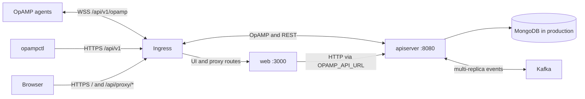

The Helm chart in
[`deploy/charts/opampcommander`](https://github.com/minuk-dev/opampcommander/tree/main/deploy/charts/opampcommander)
installs the apiserver — the server collectors connect to over OpAMP — and,
optionally, the web dashboard.

## Two-image topology

The Go **apiserver** image (`ghcr.io/minuk-dev/opampcommander`) owns REST and
OpAMP connections. The Next.js **web** image
(`ghcr.io/minuk-dev/opampcommander-web`) serves the dashboard and its HTTP
proxy. They are separate processes, can scale independently, and should use
matching published version tags. The web image does not contain the apiserver.



Browser API calls stay on the **web origin**. For example,
`/api/proxy/api/v1/namespaces/default/agents` is forwarded by the web server to
`${OPAMP_API_URL}/api/v1/namespaces/default/agents`. Set `OPAMP_API_URL` to the backend base URL
without `/api/v1` or a trailing slash, such as `http://apiserver:8080`.
It must resolve from the web container, not from the browser; `localhost`
would refer to the web container itself. Restart the web process after changing
it. It is server-side configuration, so rebuilding the image is unnecessary.

The browser and backend do not need a shared public origin or backend CORS
configuration for this proxy flow. The proxy forwards bearer authorization
(or the dashboard session cookie as a bearer token) and is not an OpAMP
WebSocket proxy. Agents always connect directly through ingress to apiserver.

### Routing patterns

| Pattern | Public routing | Web backend URL |
|---|---|---|
| Separate hosts | `console.example.com/*` → web; `api.example.com/*` → apiserver | Internal apiserver Service URL |
| One host | `/api/v1` → apiserver; `/` → web, including `/api/proxy/*` and `/auth/callback` | Internal apiserver Service URL |

For one host, use prefix matching without stripping paths. **Do not route all
of `/api` to apiserver**: that also captures the web's `/api/proxy` and session
routes. The more specific `/api/v1` rule covers both REST and OpAMP while the
web retains its own routes. With Helm, set both ingress hosts to the same host,
`apiserver.ingress.hosts[].paths[].path: /api/v1`, and
`web.ingress.hosts[].paths[].path: /`. Configure TLS for that host.
The separate-host example appears below under [Exposing the server](#exposing-the-server).

For GitHub login, the browser callback belongs to the web origin
(`/auth/callback`), which must be allowed in
`auth.oauth2.allowedRedirectHosts`. See the OAuth2 example below.

### WebSocket ingress requirements

Preserve the HTTP/1.1 `Upgrade: websocket` and `Connection: upgrade` handshake
on `/api/v1/opamp`. Set proxy read/send and load-balancer idle timeouts longer
than the agent heartbeat/ping interval, with room for delayed heartbeats
(the example below uses 3600 seconds). Apply compatible timeouts at every hop,
not only the Kubernetes ingress, and allow the expected message body sizes.

An established WebSocket stays on one backend connection. Cookie affinity is
not required for it, and reconnects may choose another replica. Affinity is
not a replacement for shared MongoDB and a cross-server event backend; HTTP
polling and management requests can reach different replicas. Keep management
port 9090 private. For agent mTLS, follow the TLS passthrough requirements below.

### Image configuration reference

Web image:

| Variable | When read | Default / purpose |
|---|---|---|
| `OPAMP_API_URL` | Server runtime | `http://localhost:8080`; apiserver origin reachable from web |
| `PORT`, `HOSTNAME` | Server startup | `3000`, `0.0.0.0`; web listener |
| `NODE_ENV`, `NEXT_TELEMETRY_DISABLED` | Image/runtime | Image sets `production`, `1` |
| `NEXT_PUBLIC_WEB_VERSION` | Build time | Displayed version; Docker build arg `VERSION` is required |
| `NEXT_PUBLIC_WEB_GIT_COMMIT` | Build time | Docker build arg `GIT_COMMIT`, default empty |
| `NEXT_PUBLIC_WEB_GIT_TREE_STATE` | Build time | Docker build arg `GIT_TREE_STATE`, default empty |
| `NEXT_PUBLIC_WEB_BUILD_DATE` | Build time | Docker build arg `BUILD_DATE`, default empty |

The `NEXT_PUBLIC_WEB_*` values are baked into the browser bundle. Changing
container environment variables does not replace them; build a new web image.
For a local build, use `docker build --build-arg VERSION=dev -t opamp-web:dev ./web`.

Apiserver image:

| Configuration | Environment equivalent | Purpose |
|---|---|---|
| `--config /path/config.yaml` | — | Mounted YAML configuration file |
| `address` | `ADDRESS` | API/OpAMP listener; use `0.0.0.0:8080` in a container |
| `management.address` | `MANAGEMENT_ADDRESS` | Private health/metrics/pprof listener |
| `database.type`, `database.endpoints` | `DATABASE_TYPE`, `DATABASE_ENDPOINTS` | `inmemory` demo or MongoDB; endpoints can be comma-separated |
| `event.type`, `event.kafka.brokers` | `EVENT_TYPE`, `EVENT_KAFKA_BROKERS` | Single-node `inmemory` or distributed event backend |
| `bootstrap.dir` | `BOOTSTRAP_DIR` | Image sets `/etc/opampcommander/initial` |
| `auth.enabled` | `AUTH_ENABLED` | Enable management API authentication |
| `auth.admin.username`, `auth.admin.password` | `AUTH_ADMIN_USERNAME`, `AUTH_ADMIN_PASSWORD` | Built-in admin credentials |
| `auth.jwt.secret`, `auth.basic.pepper` | `AUTH_JWT_SECRET`, `AUTH_BASIC_PEPPER` | Stable authentication secrets |

All registered configuration keys follow the same rule: uppercase and replace
`.` with `_` (for example `auth.jwt.refreshExpire` → `AUTH_JWT_REFRESHEXPIRE`).
Precedence is explicit flags, environment, YAML, defaults. Use
`/apiserver config view --config /path/config.yaml` to inspect effective settings
with secrets redacted, and `/apiserver --help` for the full flag list.
See [Configuration](/docs/configuration/) for TLS, OAuth2 and other settings.

## Local Compose quickstart

From the repository root, choose a published tag that exists for **both** images
(the tag has no leading `v`; consult the
[releases](https://github.com/minuk-dev/opampcommander/releases)):

```sh
export OPAMP_VERSION=0.1.41 # or a newer matching published tag
# Check the resolved configuration, then start both services.
docker compose -f deploy/compose.yaml config
docker compose -f deploy/compose.yaml up -d
```

Open `http://localhost:3000` and log in with `admin` / `local-demo-password`.
Agents on the host can use `ws://localhost:8080/api/v1/opamp`. Containers on the
Compose network use `ws://apiserver:8080/api/v1/opamp`. The dashboard may briefly
show an upstream error while apiserver initializes; `depends_on` starts the
backend first but does not wait for readiness. Inspect startup with
`docker compose -f deploy/compose.yaml logs apiserver web`.

This [Compose sample](https://github.com/minuk-dev/opampcommander/blob/main/deploy/compose.yaml)
is a single-replica, **in-memory demo**: no MongoDB or Kafka is required, and
all resource state is lost when apiserver exits. Ports bind only to loopback;
credentials are public demo values. Stop with
`docker compose -f deploy/compose.yaml down`.

For persistent single-node use, configure a MongoDB replica set and keep
`event.type: inmemory`. For HA, use shared MongoDB, stable shared authentication
secrets, and Kafka (or the chart's direct event transport); never scale the
in-memory demo. The Helm sections below cover those settings. Deployment work
is tracked in [#555](https://github.com/minuk-dev/opampcommander/issues/555) and
[#56](https://github.com/minuk-dev/opampcommander/issues/56).

## Install

From a checkout of the repository:

```bash
helm install opampcommander ./deploy/charts/opampcommander \
  --namespace opampcommander --create-namespace
```

Or from the published OCI chart:

```bash
helm install opampcommander oci://ghcr.io/minuk-dev/charts/opampcommander \
  --namespace opampcommander --create-namespace
```

The defaults install a **self-contained demo**: one apiserver replica backed by
the in-memory store, plus the dashboard. Nothing outside the cluster is
required, and nothing survives a restart.

Read the generated admin password and open the dashboard:

```bash
kubectl -n opampcommander get secret opampcommander-apiserver \
  -o jsonpath='{.data.adminPassword}' | base64 -d; echo
kubectl -n opampcommander port-forward svc/opampcommander-web 3000:3000
```

Check a release end to end with the bundled connectivity test:

```bash
helm test opampcommander --namespace opampcommander
```

## Going to production

Production deployments need persistence, stable secrets, and TLS for agent and API traffic.

### Persistence

The in-memory store is per-process. Point the chart at MongoDB — a replica set,
because the server uses transactions:

```yaml
apiserver:
  config:
    database:
      type: mongodb
      endpoints:
        - "mongodb://mongodb-0.mongodb:27017,mongodb-1.mongodb:27017/?replicaSet=rs0"
      databaseName: opampcommander
      ddlAuto: true
```

The chart does not deploy MongoDB or Kafka. Both are stateful and usually
already operated elsewhere, so the chart only points at them.

### Multiple replicas

With more than one replica, a management request may arrive at a replica that
does not hold the target agent's WebSocket. `event.type` selects how that
request is forwarded:

| `event.type` | Requires | Behaviour |
|---|---|---|
| `inmemory` | nothing | Single replica only |
| `kafka` | a broker | Events are broadcast; every replica filters |
| `direct` | nothing | Peers dial each other; exactly one replica receives |

```yaml
apiserver:
  replicaCount: 3
  config:
    event:
      type: kafka
      kafka:
        brokers: ["kafka-0.kafka:9092"]
        topic: "prod.opampcommander.events"
```

In `direct` mode the chart opens the peer port and advertises `$(POD_IP):8081`
from the downward API, so replicas find each other through the server registry
with no extra configuration.

The chart refuses to render combinations that cannot work — several replicas on
the in-memory store or the in-memory event bus, `mongodb` with no endpoints,
`kafka` with no brokers — instead of installing something subtly broken.

### Secrets

Credentials are not part of `apiserver.config`; they live in a Secret and are
injected as environment variables, which the server reads with a higher
precedence than the config file.

| Secret key | Environment variable | Purpose |
|---|---|---|
| `adminUsername` | `AUTH_ADMIN_USERNAME` | Built-in admin login |
| `adminPassword` | `AUTH_ADMIN_PASSWORD` | Built-in admin login |
| `jwtSecret` | `AUTH_JWT_SECRET` | Signs issued access tokens |
| `basicPepper` | `AUTH_BASIC_PEPPER` | Peppers stored basic-auth password hashes |
| `oauth2ClientId` | `AUTH_OAUTH2_CLIENTID` | GitHub OAuth2 app |
| `oauth2ClientSecret` | `AUTH_OAUTH2_CLIENTSECRET` | GitHub OAuth2 app |
| `oauth2StateJwtSecret` | `AUTH_OAUTH2_STATE_JWT_SECRET` | Signs the OAuth2 CSRF state token |
| `directAuthToken` | `EVENT_DIRECT_AUTHTOKEN` | Pre-shared token between peers in `direct` mode |

Values left empty are generated on install and carried forward on upgrade by
reading the Secret already in the cluster.

{}
That lookup returns nothing under `helm template` and `--dry-run`. A
render-then-apply flow (Argo CD, Flux) must supply the secrets itself, or every
render rotates them — invalidating every issued token and every stored
password. Set `apiserver.secrets.create: false` and point
`apiserver.secrets.existingSecret` at a Secret you manage.
{}

## Exposing the server

```yaml
apiserver:
  ingress:
    enabled: true
    className: nginx
    annotations:
      # /api/v1/opamp is a long-lived WebSocket upgrade.
      nginx.ingress.kubernetes.io/proxy-read-timeout: "3600"
      nginx.ingress.kubernetes.io/proxy-send-timeout: "3600"
    tls:
      - secretName: opampcommander-api-tls
        hosts: [api.opampcommander.example.com]
    hosts:
      - host: api.opampcommander.example.com
        paths:
          - path: /
            pathType: Prefix

web:
  ingress:
    enabled: true
    className: nginx
    hosts:
      - host: opampcommander.example.com
        paths:
          - path: /
            pathType: Prefix
```

### TLS at the ingress

A supported topology is `agent/client → HTTPS/WSS → ingress → HTTP/WS → apiserver`
with a private backend network. Provision the ingress TLS Secret,
redirect or reject external plaintext HTTP, and allow backend API traffic only
from the trusted ingress (for example with Kubernetes NetworkPolicies). The
apiserver can leave `tls` unset in this topology; its plaintext startup warning
is expected. Preserve WebSocket Upgrade/Connection headers and use long proxy
timeouts for `/api/v1/opamp`. Agents connect to
`wss://api.opampcommander.example.com/api/v1/opamp`.

The API currently uses Gin's default client-IP handling: `X-Forwarded-For` and
`X-Real-IP` are accepted from any peer for client-IP logging. Restrict direct
backend access and configure the ingress to discard untrusted incoming values
and set these headers itself. `Forwarded` and `X-Forwarded-Proto` do not establish
TLS or authenticated identity in the apiserver; PROXY protocol is not supported.
OAuth2 callback URLs are configured explicitly. Client-certificate headers are
not trusted: OpAMP mTLS checks the certificate from the actual TLS connection.
Use TLS passthrough to the apiserver for OpAMP mTLS so the agent certificate
reaches the listener, rather than terminating that connection at the ingress.

### TLS at the apiserver

For native HTTPS/WSS, set `apiserver.config.tls` as described in the
[Configuration guide](/docs/configuration/#listener-tls). Mount a TLS Secret
using the chart's existing `apiserver.extraVolumes` and
`apiserver.extraVolumeMounts`; avoid `subPath` mounts if the files must rotate.
Configure ingress upstream HTTPS or TLS passthrough when using this listener.
Send SIGHUP to each apiserver process after the mounted certificate and key
have updated.

If enabling `management.tls`, set `httpGet.scheme: HTTPS` on the chart's
liveness and readiness probes (and startup probe when configured). Kubernetes
HTTP probes cannot present client certificates: with `management.tls.caFile`,
supply suitable authenticated exec probes instead. Configure Prometheus to use
HTTPS, the server CA, and client credentials when required; the bundled
ServiceMonitor uses HTTP, so disable it and provide your own HTTPS
ServiceMonitor for this topology.

For OAuth2 logins from the dashboard, set the callback and the allowed redirect
host to match:

```yaml
apiserver:
  config:
    auth:
      oauth2:
        redirectUri: "https://opampcommander.example.com/auth/callback"
        allowedRedirectHosts: ["opampcommander.example.com"]
```

Health, metrics and pprof are served on a second port, which the chart puts on
its own `<release>-apiserver-management` Service, always ClusterIP — separate
from the API Service so that switching `apiserver.service.type` to NodePort or
LoadBalancer cannot publish pprof externally. Scrape it with the Prometheus
Operator instead:

```yaml
apiserver:
  serviceMonitor:
    enabled: true
```

## Configuration

`apiserver.config` is rendered verbatim into a ConfigMap and mounted at
`/etc/opampcommander/config/config.yaml`, so every key in the
[Configuration guide](/docs/configuration/) is accepted as-is — the chart keeps
no parallel schema. Container ports, probes and the Service are derived from
`address` and `management.address`, which must bind `0.0.0.0` rather than
`localhost` for the pod to be reachable.

See the
[chart README](https://github.com/minuk-dev/opampcommander/blob/main/deploy/charts/opampcommander/README.md)
for the full values reference, and
[`ci/`](https://github.com/minuk-dev/opampcommander/tree/main/deploy/charts/opampcommander/ci)
for complete example values files.

## Connect an agent

Point a collector's OpAMP extension at the apiserver's WebSocket endpoint:

```yaml
extensions:
  opamp:
    server:
      ws:
        endpoint: ws://opampcommander-apiserver.opampcommander.svc:8080/api/v1/opamp
```

## Uninstall

```bash
helm uninstall opampcommander --namespace opampcommander
```

The generated credentials Secret is removed with the release. Data in MongoDB is
not touched.
